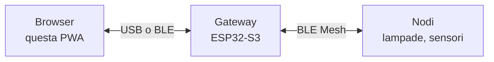

<div align="center">

# 🛰️ Mesh Gateway Configurator

**Configuratore web per il gateway Bluetooth Mesh (ESP32-S3).**
PWA senza build step: provisioning dei nodi, gruppi, relè, sensori BLE e sniffer, direttamente dal browser.


[Funzionalità](#-funzionalità) · [Architettura](#-architettura) · [Quick start](#-quick-start) · [Protocollo](#-protocollo-cfg) · [Sviluppo](#-sviluppo) · [Troubleshooting](#-troubleshooting)

</div>

---

## ✨ Funzionalità

| Tab | Cosa fa |
|---|---|
| 🧩 **Dispositivo** | Nome dell'hub, relè (stato e abilitazione), stato del modem MQTT |
| 🕸️ **Mesh** | Ricerca e provisioning dei nodi, gruppi, lampade (on/off, livello, colore), sensori (PIR, lux, potenza), rebind, calibrazione lux manuale e automatica |
| 📡 **Beacon** | Sensori BLE classici (8 slot con regole di decodifica) e sniffer BLE che evidenzia i byte che cambiano |

Altro:

- 📥 **Import di reti già provisionate** da file CDB (`.json`) o dal QR dell'app MeshProv/GDSMesh
- 🔌 **Due trasporti**: USB (Web Serial) o Bluetooth LE (Nordic UART via bridge ESP32-S3), scelti dal menu *Connetti*
- 📴 **Funziona offline** dopo il primo caricamento (service worker con aggiornamento su conferma)
- 🌗 Tema chiaro/scuro, layout adattivo per telefono e desktop

## 🏗️ Architettura



| File | Responsabilità |
|---|---|
| [`index.html`](index.html) | Struttura delle tre tab, banner di compatibilità, registrazione del service worker |
| [`app.js`](app.js) | Coda comandi (un `CFG:` alla volta, con timeout), polling di stato, collegamento tra seriale e UI |
| [`serial.js`](serial.js) | Trasporto USB/BLE, riassemblaggio delle righe, parsing dei blocchi `STATE`, `STATUS` e `SNIFF` |
| [`ui.js`](ui.js) | Rendering di nodi, gruppi, relè, sensori e sniffer; import da file e QR |
| [`style.css`](style.css) | Stili e tema chiaro/scuro |
| [`sw.js`](sw.js) | Cache degli asset statici; `CACHE_NAME` è anche la versione mostrata nell'app |
| [`vendor/jsQR.min.js`](vendor/jsQR.min.js) | Lettura del QR dell'app (unica dipendenza esterna) |

## 🚀 Quick start

**Browser:** Chrome o Edge ≥ 89. Firefox e Safari non hanno Web Serial né Web Bluetooth: la pagina mostra un banner.

1. Apri la pagina (GitHub Pages, o in locale: vedi [Sviluppo](#-sviluppo)).
2. Collega il gateway via USB, oppure accendi il bridge BLE.
3. Premi **Connetti**, scegli *USB* o *Bluetooth* e seleziona il dispositivo.
4. Dalla tab **Mesh** cerca i nuovi dispositivi e avviali al provisioning.

Per installarla come app: menu del browser › *Installa*.

## 📜 Protocollo CFG

Righe di testo `CFG:COMANDO;chiave=valore;...` a 115200 baud (USB CDC) oppure sul servizio Nordic UART (`6e400001-b5a3-f393-e0a9-e50e24dcca9e`). Ogni comando riceve `CFG:OK`, `CFG:ERR` o `CFG:BUSY`. Su BLE le righe vengono spezzate in pacchetti da 20 byte.

| Gruppo | Comandi |
|---|---|
| Stato | `STATE`, `STATUS` (relè e sensori BLE, ogni 2 s), `MODESET` |
| Provisioning | `DISCSTART`, `DISCSTOP`, `PROVISION`, `FORGET`, `RESETMESH`, `RESET` |
| Nodi | `SETNAME`, `SETKIND`, `REBIND`, `LEVEL`, `CMD`, `SETPIRSENS`, `SETLUXCALIB`, `LUXAUTOCALIB` |
| Gruppi | `GROUP`, `GRPCMD`, `GRPLEVEL`, `PAIR`, `UNPAIR` |
| Import | `IMPORTNET`, `IMPORTGROUP`, `IMPORTNODE`, `IMPORTEND` |
| Hub e relè | `SETHUBNAME`, `RELAYCFG`, `RELAYSET`, `MESHSAVE` |
| Sensori BLE | `SENSORCFG`, `RESETSENSORS`, `RESETSLOT` |
| Sniffer | `SNIFFERSTART`, `SNIFFERSTOP`, `SNIFFERDATA` |

Il parsing è documentato in testa a [`serial.js`](serial.js). Lato gateway il dispatcher è `usb_cfg_handle_line()` in `main.c` (progetto `provisioner_unified`).

## 🛠️ Sviluppo

Nessun build: HTML, CSS e JavaScript (moduli ES) serviti così come sono.

```bash
npx serve .
# oppure
python3 -m http.server
```

Servono `localhost` o HTTPS: Web Serial e Web Bluetooth non funzionano da `file://`.

**Rilascio:** incrementa `CACHE_NAME` in [`sw.js`](sw.js). Gli utenti vedono il popup *Nuova versione disponibile* e aggiornano con un tocco.

**GitHub Pages:** il repo ha `index.html` nella root. Attiva Pages sul branch `main`, cartella `/ (root)`.

## 🩺 Troubleshooting

| Sintomo | Causa probabile | Cosa fare |
|---|---|---|
| Banner "richiede Chrome o Edge" | Browser senza Web Serial / Bluetooth | Usa Chrome o Edge ≥ 89 |
| La porta non compare in elenco | Cavo solo ricarica, o permessi su Linux | Cambia cavo; su Linux `sudo usermod -a -G dialout $USER` e rifai il login |
| Il menu non offre Bluetooth | Web Bluetooth non disponibile | Usa Chrome su Android/desktop, con Bluetooth attivo |
| `timeout: nessuna risposta` nel log | Gateway occupato (import o provisioning in corso) | Attendi: l'import può richiedere fino a 45 s |
| La pagina non si aggiorna | Service worker ancora in attesa | Conferma il popup *Aggiorna*, oppure chiudi tutte le tab della PWA |
